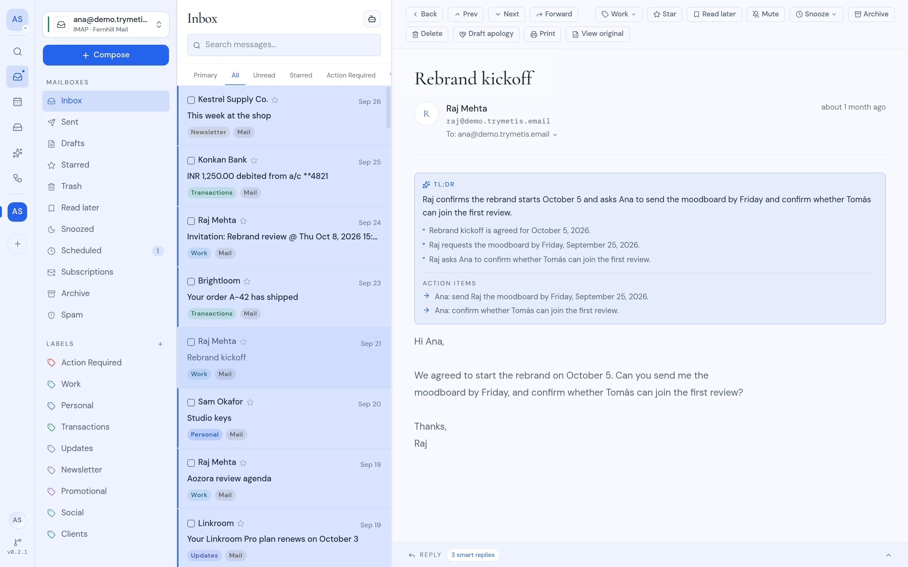
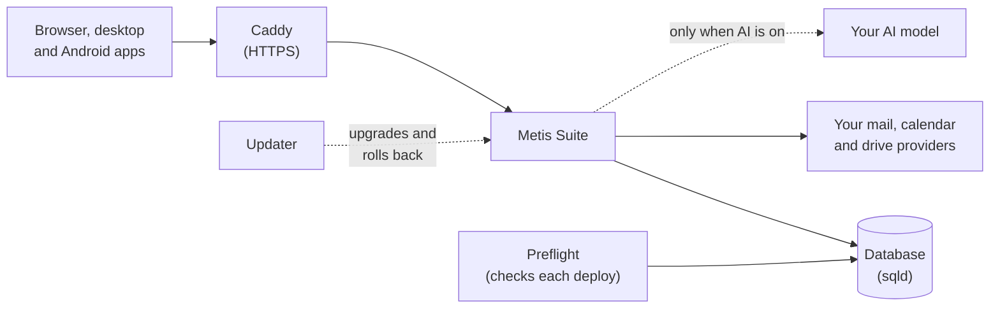

<p align="center">
  <a href="https://www.trymetis.email">
    
  </a>
</p>

<h1 align="center">Metis Suite</h1>

<p align="center"><b>Your mail, calendars and files in one place, on a server you control.</b></p>

<p align="center">
  <a href="https://www.trymetis.email">Website</a> ·
  <a href="https://docs.trymetis.email/guide">User guide</a> ·
  <a href="https://docs.trymetis.email/self-hosting">Self-hosting guide</a> ·
  <a href="https://console.trymetis.email">Metis Cloud</a>
</p>

<p align="center">
  <a href="LICENSE"></a>
</p>

<picture>
  <source media="(prefers-color-scheme: dark)" srcset="apps/docs/public/images/mail/inbox-dark.webp" />
  
</picture>

Metis Suite is an open-source mail, calendar and drive client. It connects to the accounts you already have (Gmail, Outlook, Zoho, IMAP, CalDAV and more) and puts them in one app, with an AI assistant, automations and phishing warnings on top. You run it on your own server, or we run it for you.

## Why Metis

- **One app for every account.** Several Gmail, Outlook, Zoho and IMAP inboxes in one merged list, with their calendars and drives beside them.
- **AI on your terms.** Bring your own model from OpenAI, Anthropic, or anything with an OpenAI-compatible API, including one you host. AI is off until you turn it on, and the assistant asks before it sends or deletes anything.
- **Private by default.** Remote images and trackers are blocked, stored passwords and tokens are encrypted, and everyone signs in with two-factor authentication.
- **Yours to run.** One script installs it, a dashboard configures it, and updates roll back on their own if something fails.

## Get started

**Metis Cloud.** We run a private instance for you, on your own domain or a `trymetis.email` subdomain. [Get started](https://console.trymetis.email).

**Self-host.** Free under the AGPL. You need an Ubuntu server with root access; the script installs Docker and everything else:

```bash
curl -fsSL https://sh.trymetis.email/bootstrap -o bootstrap.sh
sudo -E bash bootstrap.sh --interactive
```

The script generates every secret, starts the latest release and prints a setup code. Then:

1. Back up `METIS_ENCRYPTION_KEY` from `/opt/metis-suite/.env`. If you lose it, every user has to reconnect every account.
2. Point a domain at the server and run `sudo bash bootstrap.sh domain example.com` to get HTTPS.
3. Open `https://example.com/setup`, enter the setup code and create your account.
4. In **Dashboard → System**, add at least one provider (a Google, Microsoft or Zoho app, or your own mail and file servers), then connect your accounts.

Everything after the install, from AI models to updates and rollbacks, happens in the owner dashboard. The [self-hosting guide](https://docs.trymetis.email/self-hosting) covers requirements, installing with plain Docker Compose, every setting, backups and troubleshooting.

## Features

- **Mail.** One inbox for every account, threads, labels, snooze, read later, scheduled and undoable sends, unsubscribe in one click, and warnings on likely phishing.
- **Calendar.** Day, week, month, year and schedule views, event editing and invitations, across Google, Outlook, Zoho and CalDAV calendars.
- **Drive.** Browse, upload, search and preview files on Google Drive, OneDrive, S3, WebDAV, FTP and SFTP, and save mail attachments straight to a drive.
- **Assistant.** Ask about anything across your mailboxes, calendars and drives in one chat. Changes wait for your approval.
- **Workflows.** Build automations on a canvas that start on new mail, calendar events, drive changes, schedules or webhooks, and can wait, ask for approval, loop and use AI steps.
- **MCP.** Use your mail, calendars and drives from Claude, Cursor, VS Code or any other MCP client, limited to the workspaces you approve.
- **Workspaces.** Separate spaces for you, a team or a client, each with its own accounts, members and AI settings.
- **Apps.** Works in any browser, with a desktop app and an Android app that sign in to your own instance.

## Supported providers

| Provider                                                                                           | Mail | Calendar | Drive |
| -------------------------------------------------------------------------------------------------- | :--: | :------: | :---: |
| Google                                                                                             |  ✅  |    ✅    |  ✅   |
| Microsoft 365 / Outlook                                                                            |  ✅  |    ✅    |  ✅   |
| Zoho                                                                                               |  ✅  |    ✅    |       |
| IMAP / SMTP                                                                                        |  ✅  |          |       |
| CalDAV                                                                                             |      |    ✅    |       |
| S3, WebDAV, FTP, SFTP                                                                              |      |          |  ✅   |
| Cloudflare Email, Resend ([mail gateways](https://docs.trymetis.email/self-hosting/mail-gateways)) |  ✅  |          |       |

The instance owner decides which of these are offered. [Supported providers](https://docs.trymetis.email/guide/reference/supported-providers) lists how they differ.

## How a self-hosted instance fits together



Everything runs in Docker Compose on one server. Scheduled sends, snooze and workflows run inside the app by default, so the server has to stay on; on serverless hosts, use an external scheduler or a separate worker instead ([Background work](https://docs.trymetis.email/self-hosting/configure/background-work)).

## Develop locally

You need [Bun](https://bun.sh). The dev database is a local SQLite file, so there is nothing else to install.

```bash
bun install
cp apps/web/.env.example apps/web/.env.local
```

In `apps/web/.env.local`, fill `BETTER_AUTH_SECRET` and `METIS_ENCRYPTION_KEY` with the output of `openssl rand -base64 32`, and set `METIS_SETUP_CODE` (plus `METIS_OWNER_EMAIL` if you want the owner dashboard). Then:

```bash
bun run db:migrate
bun run dev
```

Open <http://localhost:3000/setup> and enter your setup code. The local SQLite file is only for one dev server on your own machine; anything shared uses sqld or Turso.

This is a Bun workspace with Turborepo, and every command runs from the repository root.

| Path                                                                                               | What it is                                            |
| -------------------------------------------------------------------------------------------------- | ----------------------------------------------------- |
| [`apps/web`](apps/web)                                                                             | The Metis Suite app (Next.js)                         |
| [`apps/desktop`](apps/desktop), [`apps/mobile`](apps/mobile)                                       | Desktop (Electron) and mobile (Expo) apps             |
| [`apps/docs`](apps/docs)                                                                           | The [documentation site](https://docs.trymetis.email) |
| [`apps/www`](apps/www)                                                                             | The [website](https://www.trymetis.email)             |
| [`apps/gateway-cloudflare`](apps/gateway-cloudflare), [`apps/gateway-resend`](apps/gateway-resend) | Mail gateways for Cloudflare Email and Resend         |
| [`apps/updater`](apps/updater)                                                                     | The updater service (Go)                              |
| [`packages/ui`](packages/ui)                                                                       | Shared components and theme                           |
| [`packages/shell-core`](packages/shell-core)                                                       | Logic the desktop and mobile apps share               |
| [`packages/gateway-contract`](packages/gateway-contract)                                           | The API between the app and its mail gateways         |
| [`packages/updater-proto`](packages/updater-proto)                                                 | The updater's protocol, generated for TypeScript      |
| [`e2e`](e2e)                                                                                       | End-to-end tests                                      |

[AGENTS.md](AGENTS.md) and [`agent-docs/`](agent-docs) explain the architecture and the rules every change follows.

## Get help

- **Using Metis:** the [user guide](https://docs.trymetis.email/guide).
- **Running an instance:** the [self-hosting guide](https://docs.trymetis.email/self-hosting), including [troubleshooting](https://docs.trymetis.email/self-hosting/operate/troubleshooting).
- **Bugs and ideas:** [GitHub issues](https://github.com/trymetis/metis/issues).
- **Security issues:** report them privately as described in [SECURITY.md](SECURITY.md), never as a public issue.

## Contributing

Pull requests are welcome. Read [CONTRIBUTING.md](CONTRIBUTING.md) first: every commit needs a DCO sign-off (`git commit -s`), and bigger features should start as an issue so we can agree on scope. Run `bun run typecheck` and `bun run lint` before you push; CI runs the same checks.

## License

Metis Suite is free software under the [GNU Affero General Public License v3.0 or later](LICENSE), built by AstraQ Cyber Defence.

You can run, change and share it. If you let other people use a modified version over a network, the AGPL requires you to offer them your modified source. Every page has a "Source code" link for this; point it at your fork with `METIS_SOURCE_URL`.

Third-party licenses go in `THIRD_PARTY_LICENSES.txt`, which `bun run --cwd apps/web licenses` writes and the Docker image ships. Source copied into this repository is credited in [NOTICE](NOTICE). For licensing on other terms, email contact@astraqcyberdefence.com.
